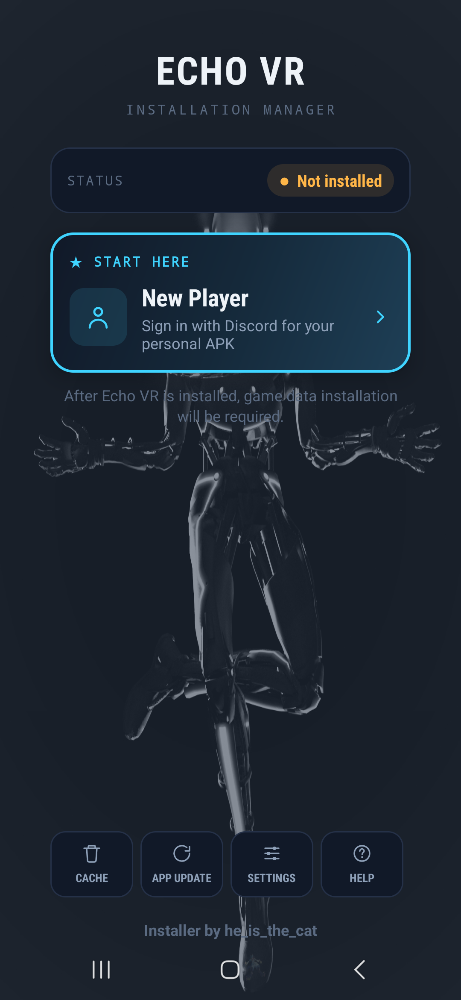
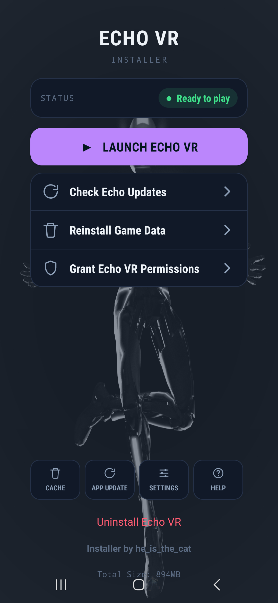

<div align="center">

# Echo VR Installer

**Install and play Echo VR on your Quest, right from the headset.**

No PC, no adb, no cables. Tap install, and you're in the arena.

[**⬇ Download the latest release**](https://github.com/heisthecat31/EchoVR-Installer/releases/latest)


&nbsp;&nbsp;


</div>

---

## Getting started

1. **Install this app** on your Quest. Download the APK from
   [Releases](https://github.com/heisthecat31/EchoVR-Installer/releases/latest) and sideload it (SideQuest, or any
   file manager on the headset).
2. **Open the installer and tap _Install Echo VR_ → _Install Echo VR_.** The latest Echo VR (about 175 MB) downloads,
   then Android asks you to confirm the install.
3. **Grant Echo VR its permissions** when the installer asks (Microphone for voice chat, plus storage).
4. **Tap _Download Game Data_** (about 940 MB) and wait for it to finish.
5. **Tap _Launch Echo VR_.** That's it.

> **Tip:** if Echo VR crashes the first time you open it, you probably launched it before granting permissions or
> downloading the game data. Do both, then restart your headset.

## Features

- **One-tap install:** gets the latest Echo VR build from the [NEVR runtime](https://github.com/EchoTools/nevr-runtime)
  releases. Every download is checked against the release's checksum and signing key before it's installed.
- **Automatic updates:** tells you when a newer Echo VR build is out and installs it over your current one. Your game
  data stays where it is.
- **Stable or beta:** pick your update channel in **Settings**. Stable is the default; beta gets new builds first.
- **Game data in the app:** downloads, checks and unpacks the 940 MB data pack, with resume if your connection drops.
- **Self-updating:** tells you when a new installer version is out and installs it for you.
- **Maintenance tools:** reinstall game data, clear the download cache, or uninstall Echo VR completely.

## Troubleshooting

| Problem | Fix |
|---|---|
| "The Echo VR already on this headset is a different build" | An Echo VR from somewhere else is installed, and Android won't install over it. Tap **Uninstall Echo VR**, then install again. |
| "Download was corrupted" | Tap the button again. The installer starts that download over. |
| Downloads don't work | Restart the headset or switch Wi-Fi networks. |
| Game crashes on launch | Grant Echo VR's permissions, reinstall game data, then restart the headset. Still crashing? Uninstall Echo VR and install it again. |
| Switched from beta to stable but nothing changed | Android can't install an older build over a newer one. You'll move to stable with its next release. |

## Building from source

The installer is a plain Android Studio project (Java, minSdk 26).

```bash
./gradlew assembleDebug
```

The APK ends up in `app/build/outputs/apk/debug/`.

---

<div align="center">

Made by **he_is_the_cat** · Fully open source · [Video guide](https://youtu.be/GQW5AAhJFDo)

</div>
