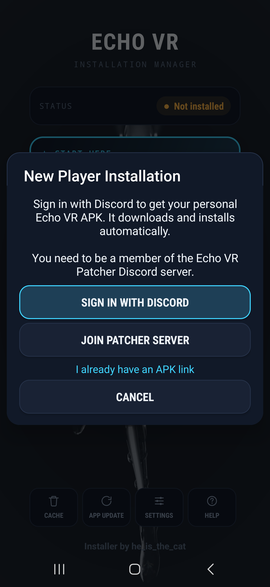

<div align="center">

# Echo VR Installer

**Install and play Echo VR on your Quest, right from the headset.**

No PC, no adb, no cables. Sign in with Discord, tap install, and you're in the arena.

[**⬇ Download the latest release**](https://github.com/heisthecat31/EchoVR-Installer/releases/latest)


&nbsp;&nbsp;

&nbsp;&nbsp;


</div>

---

## Getting started

1. **Join the Echo VR Patcher Discord:** [discord.gg/bMpsva6fmA](https://discord.gg/bMpsva6fmA). Your Discord account
   must be in this server to get a game APK.
2. **Install this app** on your Quest. Download the APK from
   [Releases](https://github.com/heisthecat31/EchoVR-Installer/releases/latest) and sideload it (SideQuest, or any
   file manager on the headset).
3. **Open the installer and tap _New Player_ → _Sign in with Discord_.** The headset browser opens Discord's sign-in
   page. Tap **Authorize**, then come back to the installer. Your personal Echo VR APK downloads and installs
   automatically.
4. **Grant Echo VR its permissions** when the installer asks (Microphone for voice chat, plus storage).
5. **Tap _Download Game Data_** (about 894 MB) and wait for it to finish.
6. **Tap _Launch Echo VR_.** That's it.

> **Tip:** if Echo VR crashes the first time you open it, you probably launched it before granting permissions or
> downloading the game data. Do both, then restart your headset.

## Features

- **One-tap install:** Discord sign-in gets your personal patched APK. There's no link to copy around.
- **Game data in the app:** downloads and unpacks the 894 MB data pack, with resume if your connection drops.
- **Automatic game updates:** applies the latest Echo VR file patches from the official update manifest.
- **Self-updating:** tells you when a new installer version is out and installs it for you.
- **Maintenance tools:** reinstall game data, clear the download cache, or uninstall Echo VR completely.

## Troubleshooting

| Problem | Fix |
|---|---|
| "Join Server First" after signing in | Join the [Echo VR Patcher Discord](https://discord.gg/bMpsva6fmA) with the same account, then try again. |
| "Phone Verification Required" | Discord needs a verified phone number for that server: Discord Settings → Account → Phone Number. |
| "Bot Busy" | Someone else's APK is being built. Wait about 30 seconds and try again. |
| Sign-in times out | If Discord showed "Service got rate limited", wait a minute and try again. |
| Links or downloads don't work | Restart the headset or switch Wi-Fi networks. |
| Game crashes on launch | Grant Echo VR's permissions, reinstall game data, then restart the headset. Still crashing? Uninstall Echo VR and install again through **New Player**. |

Already have a patched APK link from the bot? On the **New Player** screen, tap **I already have an APK link** and
paste it there.

## Building from source

The installer is a plain Android Studio project (Java, minSdk 26).

```bash
./gradlew assembleDebug
```

The APK ends up in `app/build/outputs/apk/debug/`.

---

<div align="center">

Made by **he_is_the_cat** · Fully open source · [Video guide](https://youtu.be/GQW5AAhJFDo)

</div>
